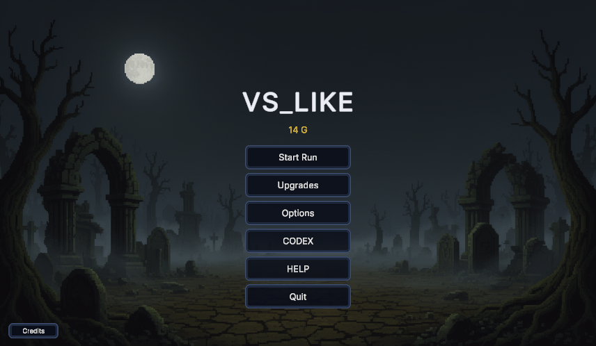
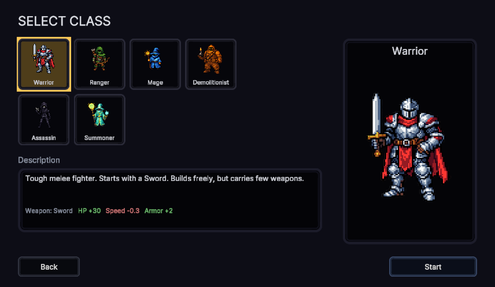
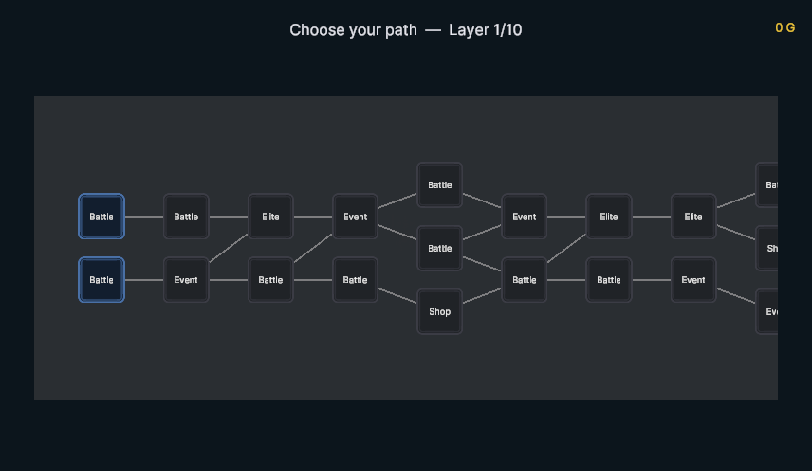
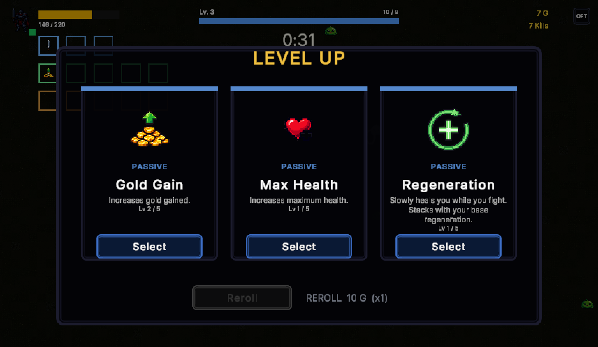

# VS_LIKE

2D 뱀서라이크(vampire-survivors-like) 로그라이트. Unity 6.3 LTS · URP · C#.
혼자 만든 개인 프로젝트이고, **시작부터 정산까지 한 판이 끝까지 도는 상태**까지 와 있습니다.



---

## 어떤 게임인가

직업을 하나 고르고, 10층짜리 분기 맵을 올라가면서 밀려드는 적을 버팁니다.
공격은 자동이라 플레이어가 하는 일은 **어디에 설지 고르는 것**뿐입니다.
레벨업 때마다 3택이 뜨고, 중간중간 상점과 이벤트가 끼어들고, 10층 끝에는 보스가 있습니다.
죽어도 모아 둔 메타 골드는 남아서 다음 판이 조금 더 강해집니다.

<table>
<tr>
<td width="50%"></td>
<td width="50%"></td>
</tr>
<tr>
<td align="center"><sub>직업 6종 — 시작 무기와 스탯이 다릅니다</sub></td>
<td align="center"><sub>10층 분기 맵 — 전투 / 엘리트 / 상점 / 이벤트</sub></td>
</tr>
</table>



<sub>레벨업 3택. 골드를 내면 리롤할 수 있습니다.</sub>

### 들어 있는 것

| | |
|---|---|
| 무기 | 13종 + 진화 무기 4종 (검·활·총·기관총·화염구·폭탄·수리검·독 장판·마이크·공전체·지뢰·소환수 2종) |
| 건물 | 10종 (터렛·곡사포·마을·농장·식당·냉각탑·사이렌·미끼·바리케이드·화톳불) |
| 패시브 | 17종 |
| 적 | 7종 · 행동 6가지(추격·원거리·돌진·측면·군집·길막) · 등장 방식 4가지 · 보스 전용 패턴 |
| 직업 | 1티어 6종 + **한 판 안에서 승급하는** 상위 직업 4종 |
| 그 밖에 | 무기 진화 · 상점 · 메타 강화 · 도감 · 랜덤 이벤트 8종 · 보물상자 · 픽업 6종 |

---

## 기술 스택과 규모

| | |
|---|---|
| 엔진 | Unity **6000.3.8f1** (6.3 LTS) · URP 17.3 · Input System 1.18 |
| 언어 | C# — **115 파일 / 21,400 줄** |
| 데이터 | 밸런스 CSV 14개 → ScriptableObject 자동 생성 |
| 아트·사운드 | 스프라이트 131장 · 효과음 33종 · BGM 4곡 (전부 직접 생성·가공) |
| 형상 관리 | Git — 커밋 241개 |
| 기간 | 2026.08.28 ~ 09.09 (작업일 12일) |

---

## 설계하면서 고민한 것들

### 1. 수치는 코드가 아니라 표에 둔다

밸런스를 만지려고 엔진을 열고 싶지 않았습니다. 그래서 모든 수치를 CSV 에 두고,
에디터 메뉴 한 번(`Game/Balance/Import CSV -> ScriptableObjects`)으로 ScriptableObject 를
다시 굽는 파이프라인을 먼저 만들었습니다.

```
Assets/Game/Balance/*.csv  ──[Import]──▶  ScriptableObject 애셋  ──▶  런타임
            ▲                                      │
            └────────────[Export · 회수용]──────────┘
```

새 무기나 이벤트를 넣을 때 **표에 줄 하나만 더하면 게임에 등장합니다.**
반대로 인스펙터에서 애셋을 직접 고치면 다음 Import 때 덮어써지기 때문에,
실수로 고친 값은 역방향 Export 로 CSV 에 회수하도록 해 뒀습니다.

여기서 한 번 데였습니다. *"CSV 값이 게임에 실렸나"* 를 씬 파일 diff 로 확인하려고 했는데,
**기본값과 같은 값은 씬에 흔적이 안 남습니다.** 그 뒤로는 이런 건 전부 런타임에서 읽어 확인합니다.

### 2. 직업을 "시작 선택"이 아니라 "도착지"로

보통 이 장르의 직업은 시작할 때 한 번 고르면 끝입니다.
여기서는 **무기 + 건물 조합으로 한 판 안에서 상위 직업으로 승급**하게 만들었습니다.
설치한 건물 앞에서 `E` 를 누르면 승급하고, 승급할 때마다 보너스가 사슬로 쌓이고 무기 소지 상한도 늘어납니다.

같은 «재료 2개 → 상위 결과» 구조를 쓰면서도 무기 진화는 **보물상자**로,
직업 승급은 **건물 앞 상호작용**으로 경로를 갈라 놓았습니다. 빌드에 목표가 두 개 생깁니다.

### 3. 아레나에 "지리"를 만들기

한참 만들고 나서야 깨달은 게 있습니다. 이 게임의 적은 **언제나 플레이어를 중심으로 한 원 위에서** 태어납니다.
그러니까 어느 쪽으로 도망쳐도 세상이 똑같이 생겼고, 결국 **위치라는 게 아무 의미가 없었습니다.**
바닥에 보상 지점을 하나 찍는 걸로는 이게 안 바뀝니다. 적이 태어나는 자리를 옮겨야 바뀝니다.

그래서 두 가지를 넣었습니다.

- **균열** — 적이 거기서 나옵니다. 내버려 두면 소환 간격이 점점 짧아지고, 부수면 닫힙니다. *"안 가면 나빠진다."*
- **도전 석상** — `E` 를 누르면 그 자리에서 엘리트가 깨어납니다. 잡으면 보상. *"가면 걸 수 있다."*

둘 다 한 지점에 발을 묶는데 **이유가 정반대**라, 같이 놓이면
*"저 균열부터 닫을까, 아니면 지금 석상을 눌러도 되나"* 하는 판단이 생깁니다.
그리고 이때서야 터렛·바리케이드·지뢰처럼 **한 지점을 지키는 건물들**이 지킬 대상을 갖게 됐습니다.

---

## 성능 — 추측을 11번 틀렸습니다

적이 많아지면 느려질 거라고 생각해서 프로파일링을 시작했는데, **세워 둔 가설 11개가 전부 틀렸습니다.**

| 내가 의심한 것 | 실측 |
|---|---|
| 적끼리 트리거 충돌 | 충돌 매트릭스에서 이미 꺼져 있었음 |
| GC 정지 | `GC.Collect` **0.000 ms** |
| 적이 많아서 느리다 | 적만 800마리 → **121 fps** |
| `OverlapCircleAll` 할당 | 프레임의 **1.3 %** |
| `Update()` 호출 비용 | 개당 **0.139 µs** |

가장 크게 배운 건 **비용 = 단가 × 빈도**라는 당연한 식이었습니다.
코드를 눈으로 읽으면 "이건 비싸 보인다"는 **단가만** 보게 됩니다.
`OverlapCircleAll` 은 한 번에 콜라이더 275개를 할당하지만 초당 30번만 돌고,
정작 프레임을 먹고 있던 무리 분리(separation)는 **초당 8,721번** 돌고 있었습니다.

그 무리 분리에서 진짜 버그가 하나 나왔습니다. 이웃 버퍼가 12칸 고정이라
**넘치는 이웃을 경고 없이 버리고 있었고**, 그래서 제가 측정하던 평균 이웃 수 10.5 는
실제 값 21.3 의 정확히 절반이었습니다. 계측기가 틀렸다는 걸 계측기로 찾은 셈입니다.

버퍼를 64로 늘려 고치면서, 미리 못박아 둔 성공 조건 5개 중 2개는 실패했다는 것도
[`Docs/PERF.md`](Docs/PERF.md) 에 그대로 남겼습니다. *"적 상한을 400 이상으로 올리면 이 판단을 다시 하라"*
는 메모를 코드 주석에도 적어 뒀습니다.

---

## 세 번 "고쳤습니다"가 거짓이었던 일

보스 방향을 가리키는 화살표가 화면에 안 보였습니다. 세 번 고쳤고, **세 번 다 검증을 통과했습니다.**
오브젝트는 생성됐고, `activeSelf` 는 `True` 였고, 위치도 각도(35.6° vs 의도한 35.0°)도 맞았습니다.

진짜 원인은 `CanvasRenderer` 누락이었습니다. `Graphic` 파생 클래스를 `AddComponent` 하면
`CanvasRenderer` 가 따라오지 않고, 그게 없으면 **예외도 경고도 없이 한 픽셀도 안 그립니다.**

이 일 때문에 판정 기준을 바꿨습니다. *"떠 있나"* 가 아니라 **실제로 렌더됐나**(`CanvasRenderer.materialCount`)를 보고,
반드시 **대조군**(확실히 보이는 HUD 체력 바)을 같은 실행 안에서 나란히 잽니다.
0 이 나와야 하는 것과 1 이 나와야 하는 것을 함께 확인하지 않으면, 통과한 검증이 아무것도 보장하지 않습니다.

지금은 이 방식이 프로젝트 전체의 기본값이 됐습니다. 예를 들어 균열이 제자리에 못 박혀 있는지 잴 때는
*"8초 동안 0.00 움직였다"* 로 끝내지 않고 **같은 자리·같은 순간에 태어난 잡몹은 12.31 움직였다**를 같이 적습니다.

---

## 작업 방식 — AI 에이전트를 어떻게 썼나

Claude Code 세션 **2개**를 같은 작업 트리·같은 Unity 에디터 위에서 굴렸습니다.
하나는 코드와 씬 배선과 플레이 검증(DEV), 하나는 그림·소리·수치와 설계 문서(CONTENT)를 맡습니다.

둘이 부딪히지 않게 먼저 정한 규칙이 있습니다 — **소유 경로**(내 것이 아니면 읽기만),
**요청 큐**(남의 영역은 고쳐 달라고 남긴다), **상태판**(에디터를 지금 누가 쓰는지), **이슈 번호 선점**.
이 규칙으로 개발 126건 · 콘텐츠 52건 · 버그 21건을 충돌 없이 처리했습니다.

그리고 AI가 **반복해서 틀리는 자리**가 생길 때마다 프로젝트 규칙 문서([`CLAUDE.md`](CLAUDE.md))에 한 줄씩 늘렸습니다.

| 밟은 함정 | 증상 | 박아 둔 규칙 |
|---|---|---|
| 미할당 Unity 필드는 "가짜 null" | `?.` 가 그냥 통과시킨다 | `?.` 금지, `if (x != null)` 로 검사 |
| Input System 전용 모드에서 옛 입력 API | 매 프레임 예외 → 에디터가 멎음 | `Keyboard.current` 로만 읽는다 |
| `Graphic` 파생에 `CanvasRenderer` 가 안 따라옴 | 경고도 예외도 없이 안 그려짐 | 파생 클래스에 직접 `[RequireComponent]` |
| `Awake` 에서 매니저 캐시 | 모든 `Awake` 는 모든 `Start` 보다 먼저 — 기능만 조용히 죽음 | `Start` 로 미루거나 지연 조회 |
| `Assets/Refresh` 가 재컴파일을 건너뜀 | 에러 0인데 새 코드가 안 들어가 있음 | 버전 상수를 조회해 반영 확인 |

결국 AI를 쓰는 일은 *"무엇을 시키나"* 보다 **"틀릴 자리를 먼저 아는 것"** 에 가까웠습니다.

---

## 지금 상태

솔직하게 적으면 이렇습니다.

| | |
|---|---|
| 기능·시스템 | **95 %** — 루프·전투·진화·승급·메타·보스·모든 화면이 돈다 |
| 콘텐츠 물량 | **70 %** — 적·무기·이벤트 종수 |
| 체감 검증 | **4 %** — 사람이 직접 플레이해야만 판정되는 항목 121개 중 5개 확인 |

마지막 피드백 20건을 정리하면서 알게 된 게 있습니다. 새 시스템은 하나도 안 늘었는데 지적은 계속 나왔고,
거의 전부 **"이미 있는 것이 안 보였다"** 였습니다. 기능 갭이 아니라 **전달 갭**이었습니다.
그래서 다음 순서는 새 기능이 아니라 ① 화면이 사실을 다 적게 만드는 것, ② 체감 수치를 플레이하며 맞추는 것입니다.
무엇을 보고 어느 파일의 어떤 값을 고칠지까지 [`Docs/TODO.md`](Docs/TODO.md) 에 적어 뒀습니다.

---

## 실행

1. Unity **6000.3.8f1** 로 프로젝트를 엽니다 (다른 버전은 URP 설정이 깨질 수 있습니다).
2. `Assets/Scenes/SampleScene.unity` 를 열고 재생.
3. CSV 를 고쳤다면 `Game/Balance/Import CSV -> ScriptableObjects` 를 한 번 실행합니다.

조작은 `WASD` 이동 / `Z` 건물 설치 / `E` 상호작용(석상·제단) / `ESC` 일시정지,
그리고 에디터에서는 `` ` `` 로 개발용 치트 패널이 열립니다. 공격은 자동입니다.

---

## 문서

작업 이력과 근거를 코드만큼 챙긴 프로젝트입니다. 커밋 하나하나가 원인 · 바꾼 파일 · 검증 로그를 들고 있어서,
반년 뒤에 *"이 수치가 왜 이렇게 됐나"* 를 커밋 하나로 답할 수 있게 해 두었습니다.

| 문서 | 담는 것 |
|---|---|
| [`Docs/SETUP_STATUS.md`](Docs/SETUP_STATUS.md) | 완료 이력 — 원인, 바꾼 파일, 검증 로그(대조군 포함) |
| [`Docs/TODO.md`](Docs/TODO.md) | 아직 안 된 것 · 미검증 경로 · 결정 대기 |
| [`Docs/BALANCE.md`](Docs/BALANCE.md) | 수치를 고치는 법과 현재 값의 근거 |
| [`Docs/TUNING.md`](Docs/TUNING.md) | 사람이 플레이해야만 판정되는 항목 |
| [`Docs/PERF.md`](Docs/PERF.md) | 성능 측정 기록 (죽은 가설 11개 포함) |
| [`Docs/ROADMAP.md`](Docs/ROADMAP.md) | 장르 완성도 갭 분석 |
| [`Docs/Parallel/`](Docs/Parallel/) | 두 세션 병렬 작업 규칙 · 버그 대장 · 요청 기록 |
